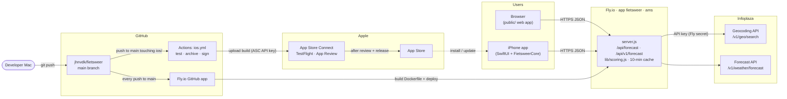

# Fietsweer

A responsive cycling weather app. Choose a place to see cycling scores for up to 15 days ahead (scores more than 7 days out are marked as unsure). The comparison lets you pick a period: the next 3 days, this weekend, next week or next weekend.

Weather data comes from [Infoplaza](https://platform.infoplaza.com/reference/v1-weather-forecast), and location search uses the [Infoplaza Geocoding Search API](https://platform.infoplaza.com/reference/v1-geo-search). The server uses Node.js built-in HTTP and `fetch` APIs.

## Architecture



- **Runtime:** the website and the iPhone app both call the same server on Fly.io. The server looks up places and forecasts at Infoplaza, computes the cycling scores, and caches results for 10 minutes. The Infoplaza key lives only on the server.
- **Server releases:** the Fly.io GitHub app deploys every push to `main` automatically. Scoring changes go live without an App Store update.
- **App releases:** a push to `main` that touches `ios/` makes GitHub Actions build, sign and upload a TestFlight build. You then pick that build in App Store Connect and submit it for review.

## Run locally

Requires Node.js 20.18 or newer.

```sh
npm start
```

Put `INFOPLAZA_API_KEY=your_api_key` in the ignored `.env` file. Both `npm start` and `npm run dev` load it automatically. Open http://localhost:8080.

Use the current-location button to request your device's location. The browser asks for permission, and location access requires HTTPS (localhost is supported).

On Fly.io, the app reads `INFOPLAZA_API_KEY` from the existing Fly secret; no local `.env` file is needed in the image.

Run the syntax checks with `npm run check`.

## Deploy to Fly.io

The Fly.io GitHub app deploys every push to `main` automatically. To deploy by hand instead, install and sign in to the [Fly CLI](https://fly.io/docs/flyctl/install/) and run `fly deploy` from this directory.

The included `fly.toml` targets the existing app `fietsweer` in the Amsterdam region. Fly builds the included Dockerfile and injects its configured secrets at runtime.

## GitHub

After creating a GitHub repository, connect and push this project:

```sh
git init
git add .
git commit -m "Build Fietsweer weather forecast app"
git branch -M main
git remote add origin https://github.com/jhnvdk/fietsweer.git
git push -u origin main
```
## iPhone app

The native SwiftUI app lives in [`ios/`](ios/) and uses the same server (`/api/v1/forecast`). Scores are computed on the server in [`lib/scoring.js`](lib/scoring.js), so the website and the app always agree.

- `ios/FietsweerCore`: shared Swift code (API client, models, trip periods). Compile it locally with `swift build`.
- `ios/Fietsweer`: SwiftUI screens. `ios/project.yml` describes the Xcode project; [XcodeGen](https://github.com/yonaskolb/XcodeGen) generates it, so no `.xcodeproj` is committed.
- [`.github/workflows/ios.yml`](.github/workflows/ios.yml) runs the tests and builds the app on pull requests. On every push to `main` that touches `ios/`, it also uploads a build to TestFlight. It needs the repository secrets `ASC_KEY_ID`, `ASC_ISSUER_ID`, `ASC_KEY_P8` (base64) and `APPLE_TEAM_ID`.

To change the score rules, edit `lib/scoring.js` and deploy the server. Both apps pick up the change without an App Store update. Keep `/api/v1` backwards compatible: only add fields.
